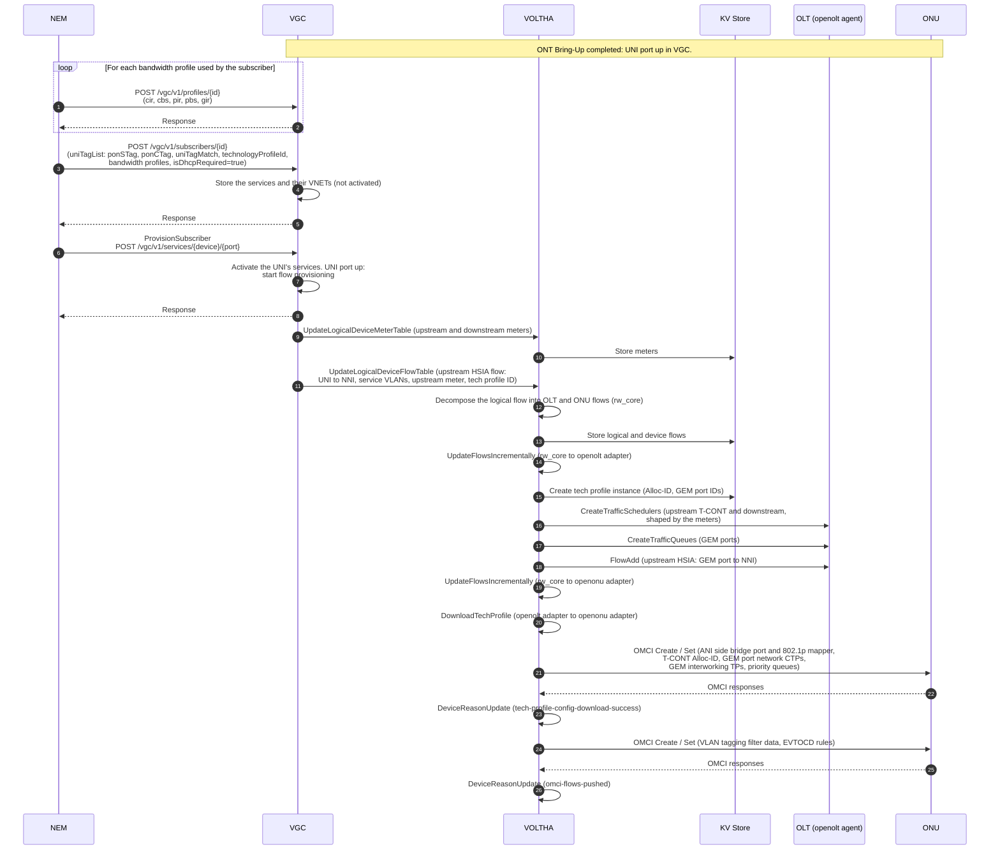
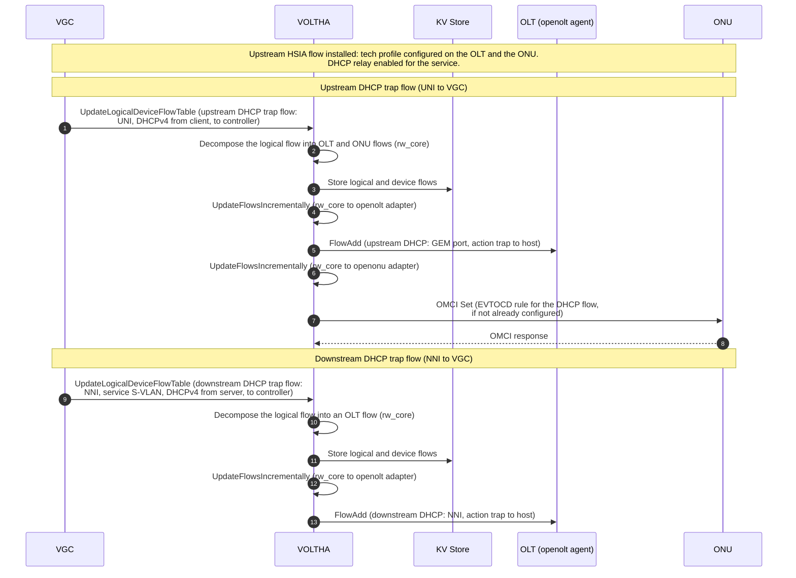
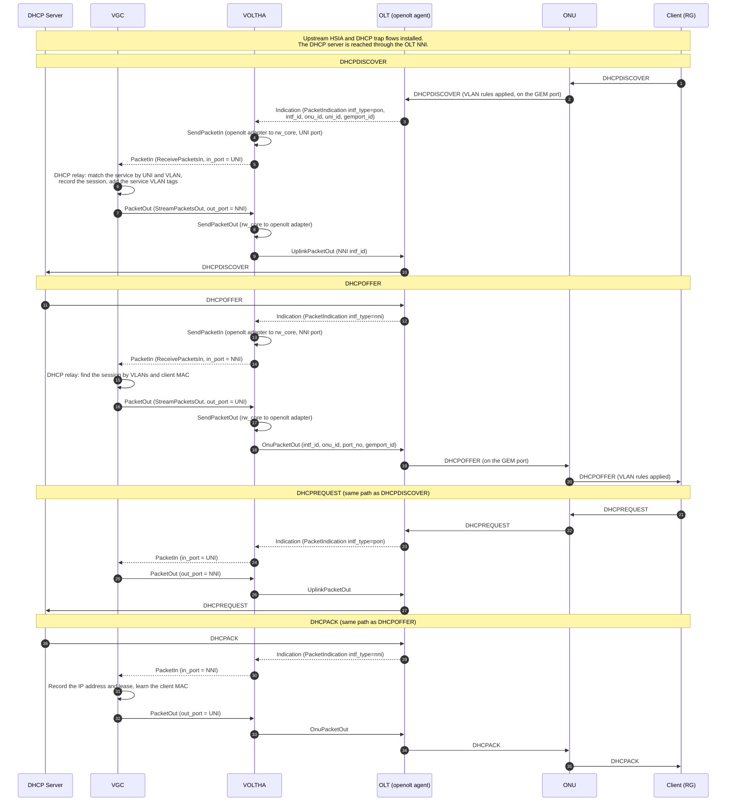
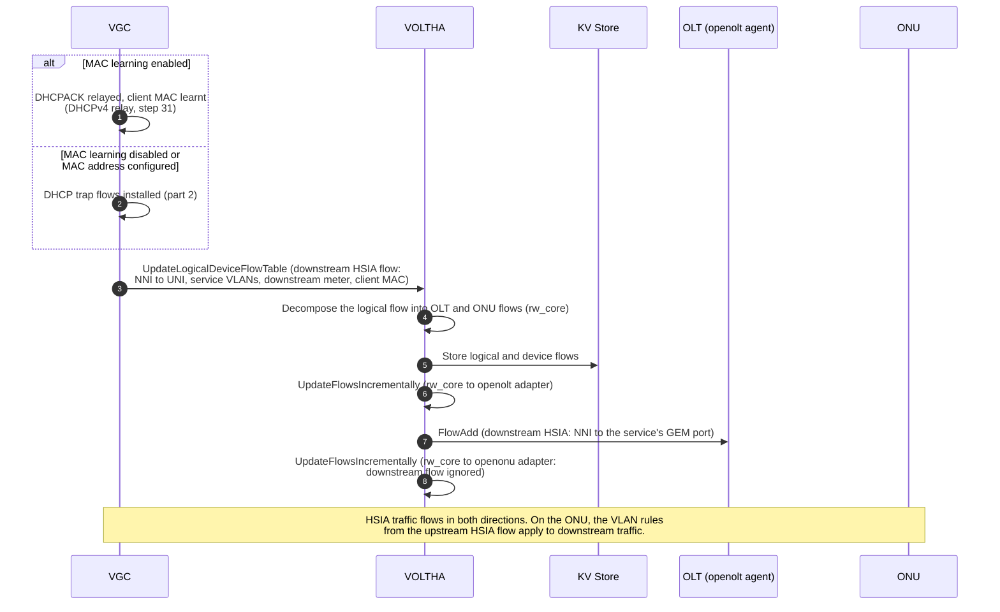

# HSIA and DHCP Workflow

See [VOLTHA Message Flows](index.md) for the participants and the diagram
conventions.

NEM gives service to a subscriber with a single call, the same as with the
ONOS vOLT (olt) application:

- **ProvisionSubscriber**: `POST /vgc/v1/services/{device}/{port}`, the
  equivalent of the ONOS olt app's `POST /onos/olt/oltapp/{device}/{port}`.
  `{device}` is the OLT's logical device ID and `{port}` the UNI port number.
  It activates all services of the subscriber on that UNI.
- **ProvisionService**: `POST /vgc/v1/services/{portName}/{sTag}/{cTag}/{tpId}`,
  the equivalent of the ONOS olt app's
  `POST /onos/olt/oltapp/services/{portName}/{sTag}/{cTag}/{tpId}`. It
  activates a single service of the subscriber.

`DELETE` on the same paths removes the subscriber or the service and its
flows. As with SADIS in ONOS, the configuration must be in VGC before the
subscriber is provisioned, in this order:

1. `POST /vgc/v1/profiles/{id}` for each bandwidth profile. Adding a service
   fails if its bandwidth profiles are missing.
2. `POST /vgc/v1/subscribers/{id}` for the subscriber's services: service
   VLANs, technology profile, bandwidth profiles, and `isDhcpRequired=true`
   for DHCP relay. VGC stores the services as not activated and installs no
   flows.
3. ProvisionSubscriber (or ProvisionService) activates them. If it is called
   before step 2, VGC finds no service for the UNI and does nothing, and it
   has to be called again after the services are added.

If the subscriber is provisioned before the ONU is discovered, VGC installs
the flows when the UNI port comes up (step 44 of the [ONT Bring-Up Workflow](ont-bring-up.md)).
VGC installs the flows in this order, and the diagrams follow it:

1. **Upstream HSIA flow**, with the service meters. It is the first flow that
   carries the service's technology profile, so it creates the tech profile
   on the OLT (T-CONT scheduler, GEM port queues) and on the ONU (OMCI).
2. **DHCP trap flows**, upstream on the UNI and downstream on the NNI. They
   reuse the tech profile created in part 1.
3. **DHCPv4 relay**: VGC relays the trapped DHCP messages between the UNI and
   the NNI and learns the client MAC address.
4. **Downstream HSIA flow**: installed right after part 2 when MAC learning is
   disabled or a MAC address is configured, otherwise after the DHCPACK with
   the learnt MAC address.

The upstream flows also configure the ONU's VLAN rules (EVTOCD), which apply
in both directions; the openonu adapter ignores the downstream flows.

## 1. Subscriber provisioning and upstream HSIA flow

### Step description (part 1)

| Step | From → To | Message | Description |
| --- | --- | --- | --- |
| 1–2 | NEM → VGC | `POST /vgc/v1/profiles/{id}` | NEM adds each bandwidth profile the subscriber's services use (CIR, CBS, PIR, PBS, GIR). VGC turns them into meters when the flows are installed. |
| 3 | NEM → VGC | `POST /vgc/v1/subscribers/{id}` | NEM adds the subscriber's services on the UNI (the equivalent of the SADIS subscriber entry): service VLANs (`ponSTag`, `ponCTag`, `uniTagMatch`), technology profile ID, upstream and downstream bandwidth profiles, and `isDhcpRequired=true` to enable DHCP relay. |
| 4 | VGC (internal) | Store services | VGC creates the services and their VNETs. They are not activated, so no flows are installed. |
| 5 | VGC → NEM | Response | Result of the request. |
| 6 | NEM → VGC | ProvisionSubscriber (`POST /vgc/v1/services/{device}/{port}`) | NEM gives service to the subscriber on the UNI: `{device}` is the OLT's logical device ID and `{port}` the UNI port number. ProvisionService (`POST /vgc/v1/services/{portName}/{sTag}/{cTag}/{tpId}`) does the same for a single service. |
| 7 | VGC (internal) | Activate services | VGC activates the services configured for the UNI. Because the UNI and NNI ports are up, it starts installing their flows. |
| 8 | VGC → NEM | Response | VGC answers once the services are activated; the flows are installed asynchronously. |
| 9 | VGC → VOLTHA | `UpdateLogicalDeviceMeterTable` | Upstream and downstream meters derived from the service's bandwidth profiles. |
| 10 | VOLTHA → KV Store | Store meters | rw_core persists the meters on the logical device. |
| 11 | VGC → VOLTHA | `UpdateLogicalDeviceFlowTable` | The upstream HSIA flow: from the UNI port to the NNI port, with the service VLAN handling. Its metadata carries the technology profile ID and the upstream meter. |
| 12 | VOLTHA (internal) | Flow decomposition | rw_core splits the logical flow into an ONU flow (VLAN handling on the UNI) and an OLT flow (forwarding to the NNI). |
| 13 | VOLTHA → KV Store | Store flows | Logical and device flows are persisted. |
| 14 | VOLTHA (internal) | `UpdateFlowsIncrementally` | rw_core sends the OLT flow to the openolt adapter. |
| 15 | VOLTHA → KV Store | Tech profile instance | This is the first flow of the UNI with this technology profile, so the openolt adapter creates the tech profile instance and allocates the Alloc-ID and GEM port IDs from the PON resource pools. |
| 16–17 | VOLTHA → OLT | `CreateTrafficSchedulers`, `CreateTrafficQueues` | The OLT creates the upstream (T-CONT) and downstream schedulers, shaped by the meters, and the GEM port queues. |
| 18 | VOLTHA → OLT | `FlowAdd` | The upstream HSIA flow is installed on the OLT: traffic from the service's GEM port is forwarded to the NNI. |
| 19 | VOLTHA (internal) | `UpdateFlowsIncrementally` | rw_core sends the ONU flow to the openonu adapter. |
| 20 | VOLTHA (internal) | `DownloadTechProfile` | The openolt adapter sends the tech profile instance to the openonu adapter (adapter-to-adapter gRPC). |
| 21–22 | VOLTHA ↔ ONU | OMCI Create / Set | The openonu adapter configures the ANI side: MAC bridge port and 802.1p mapper, the T-CONT with its Alloc-ID, GEM port network CTPs, GEM interworking termination points and priority queues. OMCI follows the path shown in the [ONT Bring-Up Workflow](ont-bring-up.md). |
| 23 | VOLTHA (internal) | `DeviceReasonUpdate` | Device reason `tech-profile-config-download-success`. |
| 24–25 | VOLTHA ↔ ONU | OMCI Create / Set | The ONU flow is applied as VLAN tagging filter data and Extended VLAN Tagging Operation (EVTOCD) rules on the UNI. |
| 26 | VOLTHA (internal) | `DeviceReasonUpdate` | Device reason `omci-flows-pushed`. |

## 2. DHCP trap flows

### Step description (part 2)

| Step | From → To | Message | Description |
| --- | --- | --- | --- |
| 1 | VGC → VOLTHA | `UpdateLogicalDeviceFlowTable` | The upstream DHCP trap flow matches DHCPv4 from the client on the UNI port (UDP 68 to 67) with the service VLAN and sends it to the controller. Its metadata carries the same technology profile ID and upstream meter as the HSIA flow. |
| 2 | VOLTHA (internal) | Flow decomposition | rw_core splits the flow into an ONU flow (VLAN handling on the UNI) and an OLT flow (trap to host). |
| 3 | VOLTHA → KV Store | Store flows | Logical and device flows are persisted. |
| 4 | VOLTHA (internal) | `UpdateFlowsIncrementally` | rw_core sends the OLT flow to the openolt adapter. The tech profile instance already exists, so no scheduler or queue is created. |
| 5 | VOLTHA → OLT | `FlowAdd` | The OLT traps DHCP packets arriving on the service's GEM port to the host: they are sent to VOLTHA as `PacketIndication` instead of being forwarded. |
| 6 | VOLTHA (internal) | `UpdateFlowsIncrementally` | rw_core sends the ONU flow to the openonu adapter. The tech profile is already configured on the ONU. |
| 7–8 | VOLTHA ↔ ONU | OMCI Set | The openonu adapter adds the EVTOCD rule for the DHCP flow when the VLAN handling differs from the rules already configured, so the client's DHCP packets are tagged with the service VLAN and sent upstream on the service's GEM port. |
| 9 | VGC → VOLTHA | `UpdateLogicalDeviceFlowTable` | The downstream DHCP trap flow matches DHCPv4 from the server on the NNI port (UDP 67 to 68) with the service S-VLAN and sends it to the controller. |
| 10 | VOLTHA (internal) | Flow decomposition | The flow starts on the NNI and ends at the controller, so it has an OLT part only. |
| 11 | VOLTHA → KV Store | Store flows | Logical and device flows are persisted. |
| 12 | VOLTHA (internal) | `UpdateFlowsIncrementally` | rw_core sends the OLT flow to the openolt adapter. |
| 13 | VOLTHA → OLT | `FlowAdd` | The OLT traps DHCP replies arriving on the NNI to the host. |

## 3. DHCPv4 relay

### Step description (part 3)

| Step | From → To | Message | Description |
| --- | --- | --- | --- |
| 1–2 | Client → ONU → OLT | DHCPDISCOVER | The ONU applies the VLAN rules configured for the upstream flows and sends the packet upstream on the service's GEM port. |
| 3 | OLT → VOLTHA | `PacketIndication` (`intf_type=pon`) | The upstream DHCP trap flow matches and the OLT sends the packet on the indication stream, with the PON interface, ONU, UNI and GEM port it came from. |
| 4 | VOLTHA (internal) | `SendPacketIn` | The openolt adapter passes the packet to rw_core with the UNI logical port number. |
| 5 | VOLTHA → VGC | `PacketIn` | Delivered on the `ReceivePacketsIn` stream, `in_port` = UNI. |
| 6 | VGC (internal) | DHCP relay | VGC finds the service by UNI and VLAN, records the DHCP session (client MAC) and adds the service VLAN tags for the network side (and Option 82, if enabled for the service). |
| 7 | VGC → VOLTHA | `PacketOut` | Sent on the `StreamPacketsOut` stream, `out_port` = NNI. |
| 8 | VOLTHA (internal) | `SendPacketOut` | rw_core passes the packet to the openolt adapter. |
| 9–10 | VOLTHA → OLT → DHCP Server | `UplinkPacketOut` | The OLT sends the packet out of the NNI towards the DHCP server. |
| 11–12 | DHCP Server → OLT → VOLTHA | DHCPOFFER, `PacketIndication` (`intf_type=nni`) | The downstream DHCP trap flow on the NNI matches and the OLT sends the packet on the indication stream. |
| 13–14 | VOLTHA → VGC | `SendPacketIn`, `PacketIn` | Same internal path as steps 4–5, `in_port` = NNI. |
| 15 | VGC (internal) | DHCP relay | VGC finds the DHCP session by VLANs and client MAC, and prepares the packet for the UNI. |
| 16–17 | VGC → VOLTHA | `PacketOut`, `SendPacketOut` | `out_port` = UNI. |
| 18 | VOLTHA → OLT | `OnuPacketOut` | The openolt adapter selects the GEM port of the subscriber's service and sends the packet with the PON interface, ONU-ID and port number. |
| 19–20 | OLT → ONU → Client | DHCPOFFER | The ONU applies its VLAN rules and forwards the packet to the client. |
| 21–27 | Client → … → DHCP Server | DHCPREQUEST | Same path as DHCPDISCOVER (steps 1–10). The VOLTHA-internal steps are not repeated. |
| 28–30 | DHCP Server → … → VGC | DHCPACK | Same path as DHCPOFFER (steps 11–14). |
| 31 | VGC (internal) | Lease recorded | VGC records the assigned IP address and lease time for the service and learns the client MAC address. With MAC learning enabled, this triggers the downstream HSIA flow (part 4). |
| 32–35 | VGC → … → Client | DHCPACK | Same path as DHCPOFFER (steps 16–20). |

## 4. Downstream HSIA flow

### Step description (part 4)

| Step | From → To | Message | Description |
| --- | --- | --- | --- |
| 1 | VGC (internal) | Trigger, MAC learning enabled | VGC learnt the client MAC address from the DHCPACK (step 31 of the DHCPv4 relay). |
| 2 | VGC (internal) | Trigger, no MAC learning | Without MAC learning, or with a MAC address configured for the service, VGC installs the downstream HSIA flow right after the DHCP trap flows. |
| 3 | VGC → VOLTHA | `UpdateLogicalDeviceFlowTable` | The downstream HSIA flow: from the NNI port to the UNI port, with the service VLAN handling and the downstream meter. With MAC learning it also matches the client's MAC address as destination. |
| 4 | VOLTHA (internal) | Flow decomposition | rw_core splits the logical flow into an OLT flow and an ONU flow. |
| 5 | VOLTHA → KV Store | Store flows | Logical and device flows are persisted. |
| 6 | VOLTHA (internal) | `UpdateFlowsIncrementally` | rw_core sends the OLT flow to the openolt adapter. The downstream scheduler and queues were created with the upstream HSIA flow. |
| 7 | VOLTHA → OLT | `FlowAdd` | Traffic from the NNI for the service is forwarded on the service's GEM port. |
| 8 | VOLTHA (internal) | `UpdateFlowsIncrementally` | rw_core sends the ONU flow to the openonu adapter, which ignores downstream flows: the EVTOCD rules configured for the upstream HSIA flow also handle downstream traffic. |
