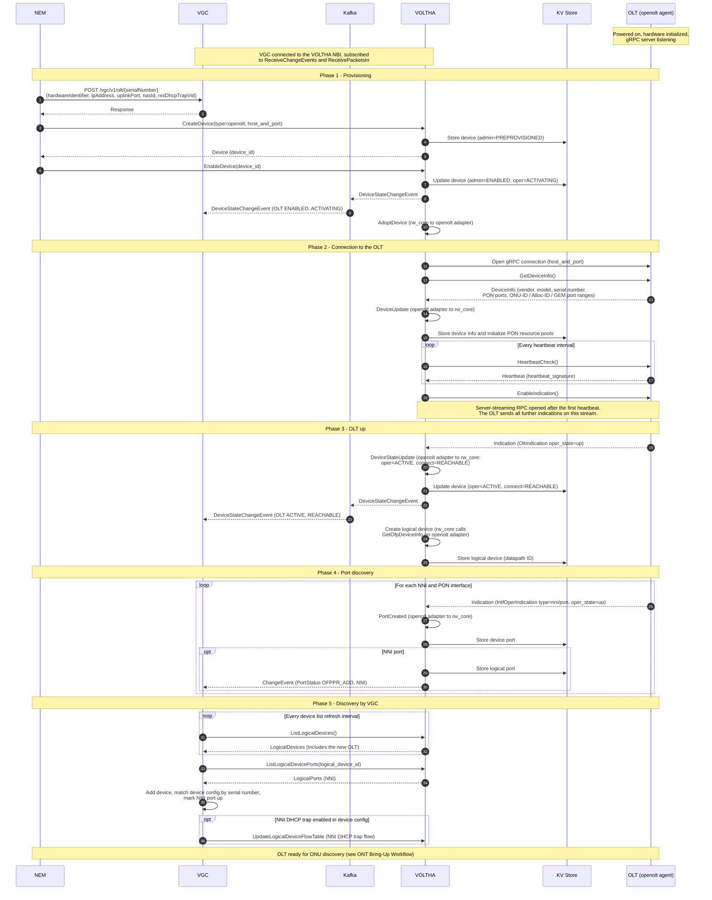

# OLT Bring-Up Workflow

See [VOLTHA Message Flows](index.md) for the participants and the diagram
conventions.

The OLT is powered on, the openolt agent has initialized the OLT hardware and
listens for gRPC connections. VGC is already connected to the VOLTHA NBI.
NEM stores the OLT configuration in VGC and creates and enables the OLT
directly on the VOLTHA NBI (VGC has no API to create or enable an OLT, and
never calls `CreateDevice` or `EnableDevice` itself). VOLTHA connects to the
OLT and learns its capabilities, and the OLT is presented to VGC as a logical
device with its NNI ports, which VGC discovers by polling VOLTHA.

## Step description

| Step | From → To | Message | Description |
| --- | --- | --- | --- |
| 1 | NEM → VGC | `POST /vgc/v1/olt/{serialNumber}` | NEM adds the OLT device configuration to VGC (the equivalent of the SADIS OLT entry): hardware identifier, IP address, uplink (NNI) port, NAS ID and the NNI DHCP trap setting. Like the bandwidth profiles and subscriber configuration, it is stored in VGC and used once the OLT is discovered. |
| 2 | VGC → NEM | Response | Result of the request. |
| 3 | NEM → VOLTHA | `CreateDevice` | NEM pre-provisions the OLT directly on the VOLTHA gRPC NBI, with its device type (`openolt`) and the agent's gRPC address. |
| 4 | VOLTHA → KV Store | Store device | rw_core creates a device agent and persists the device with admin state `PREPROVISIONED`. |
| 5 | VOLTHA → NEM | `Device` | The new device, including the `device_id` used in the following call. |
| 6 | NEM → VOLTHA | `EnableDevice` | NEM requests activation of the OLT. |
| 7 | VOLTHA → KV Store | Update device | Admin state `ENABLED`, oper status `ACTIVATING`, and the adapter endpoint that serves this device type. |
| 8–9 | VOLTHA → Kafka → VGC | `DeviceStateChangeEvent` | rw_core publishes an event on `voltha.events` whenever the admin, oper or connect state of a device changes. VGC consumes these events. |
| 10 | VOLTHA (internal) | `AdoptDevice` | rw_core asks the openolt adapter to adopt the device. |
| 11 | VOLTHA → OLT | gRPC connect | The openolt adapter opens a gRPC connection to the openolt agent. |
| 12–13 | VOLTHA ↔ OLT | `GetDeviceInfo` / `DeviceInfo` | The OLT reports vendor, model, serial number, firmware, number of PON ports, and the ONU-ID, Alloc-ID and GEM port ID ranges. |
| 14 | VOLTHA (internal) | `DeviceUpdate` | The openolt adapter updates the device in rw_core with the reported information. |
| 15 | VOLTHA → KV Store | Store resources | Device info is stored, and the openolt adapter's resource manager initializes the per-PON resource pools (ONU-ID, Alloc-ID, GEM port). |
| 16–17 | VOLTHA ↔ OLT | `HeartbeatCheck` / `Heartbeat` | Periodic liveness check. A changed `heartbeat_signature` means the OLT rebooted. |
| 18 | VOLTHA → OLT | `EnableIndication` | Opened after the first successful heartbeat. This server-streaming RPC carries all asynchronous indications from the OLT (OLT, interface, ONU, OMCI, packet-in, alarms and statistics). |
| 19 | OLT → VOLTHA | `OltIndication` (up) | The OLT reports that it is operational. |
| 20 | VOLTHA (internal) | `DeviceStateUpdate` | The openolt adapter sets the device to oper `ACTIVE`, connect `REACHABLE`. |
| 21 | VOLTHA → KV Store | Update device | New device state persisted. |
| 22–23 | VOLTHA → Kafka → VGC | `DeviceStateChangeEvent` | VGC is informed that the OLT is active and reachable. |
| 24 | VOLTHA (internal) | Create logical device | The `ACTIVATING` → `ACTIVE` transition triggers logical device creation. rw_core gets the switch capabilities from the openolt adapter (`GetOfpDeviceInfo`) and derives the datapath ID from the OLT serial number. |
| 25 | VOLTHA → KV Store | Store logical device | The logical device is persisted. |
| 26 | OLT → VOLTHA | `IntfOperIndication` | One indication per NNI and PON interface. |
| 27 | VOLTHA (internal) | `PortCreated` | The openolt adapter creates the port in rw_core (`PortStateUpdate` if the port already exists). |
| 28 | VOLTHA → KV Store | Store device port | The port is persisted. |
| 29 | VOLTHA → KV Store | Store logical port | NNI ports become logical ports. PON ports do not; UNI logical ports are added later per ONU. |
| 30 | VOLTHA → VGC | `ChangeEvent` (`OFPPR_ADD`) | Port status event on the `ReceiveChangeEvents` stream. If VGC has not discovered the logical device yet, it ignores the event and learns the port in step 33. |
| 31–32 | VGC ↔ VOLTHA | `ListLogicalDevices` | VGC polls the logical device list periodically and detects the new OLT. |
| 33–34 | VGC ↔ VOLTHA | `ListLogicalDevicePorts` | VGC audits the ports of the new logical device. |
| 35 | VGC (internal) | Add device | VGC creates its device object, matches it by serial number with the OLT device configuration from step 1, and marks the NNI port up. |
| 36 | VGC → VOLTHA | `UpdateLogicalDeviceFlowTable` | If the NNI DHCP trap is enabled in the device configuration, VGC installs the NNI DHCP trap flow. Further DHCP flows are installed per subscriber service, as described in the [HSIA and DHCP Workflow](hsia-dhcp.md). |
