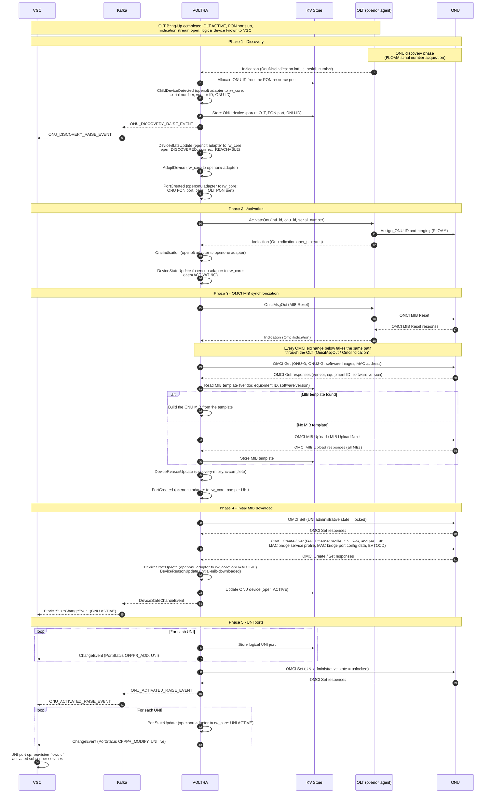

# ONT Bring-Up Workflow

See [VOLTHA Message Flows](index.md) for the participants and the diagram
conventions.

The [OLT Bring-Up Workflow](olt-bring-up.md) has completed: the OLT is active,
its PON ports are up, the indication stream is open and VGC knows the OLT's
logical device. ONU discovery is autonomous; no request from NEM or VGC is
needed. The OLT reports a new ONU, VOLTHA creates it as a child device of the
OLT and activates it on the PON, the openonu adapter synchronizes the ONU's MIB
over OMCI and applies the initial configuration, and the ONU's UNI ports are
presented to VGC as logical ports of the OLT's logical device.

## Step description

| Step | From → To | Message | Description |
| --- | --- | --- | --- |
| 1 | OLT → VOLTHA | `OnuDiscIndication` | During the ONU discovery phase the OLT acquires the serial number of the new ONU over PLOAM. It then reports the ONU (PON interface and serial number) on the indication stream. |
| 2 | VOLTHA → KV Store | Allocate ONU-ID | The openolt adapter's resource manager allocates an ONU-ID from the PON's resource pool. |
| 3 | VOLTHA (internal) | `ChildDeviceDetected` | The openolt adapter asks rw_core to create a child device of the OLT. rw_core selects the ONU adapter from the vendor ID in the serial number and sets the proxy address (OLT, PON port, ONU-ID). |
| 4 | VOLTHA → KV Store | Store ONU device | The ONU device is persisted. rw_core then enables the child device automatically. |
| 5–6 | VOLTHA → Kafka → VGC | `ONU_DISCOVERY_RAISE_EVENT` | Discovery event published by the openolt adapter on `voltha.events`. Every ONU admin, oper or connect state change also publishes a `DeviceStateChangeEvent`, as in the OLT flow. |
| 7 | VOLTHA (internal) | `DeviceStateUpdate` | The openolt adapter sets the ONU to oper `DISCOVERED`, connect `REACHABLE`. |
| 8 | VOLTHA (internal) | `AdoptDevice` | rw_core asks the openonu adapter to adopt the ONU. |
| 9 | VOLTHA (internal) | `PortCreated` | The openonu adapter creates the ONU's PON port, with the OLT PON port as its peer. |
| 10 | VOLTHA → OLT | `ActivateOnu` | The openolt adapter activates the ONU with its ONU-ID and serial number. |
| 11 | OLT → ONU | `Assign_ONU-ID`, ranging (PLOAM) | The OLT assigns the ONU-ID, ranges the ONU and sets up the OMCI channel. |
| 12 | OLT → VOLTHA | `OnuIndication` (up) | The ONU is operational on the PON. |
| 13 | VOLTHA (internal) | `OnuIndication` | The openolt adapter forwards the indication to the openonu adapter (adapter-to-adapter gRPC). |
| 14 | VOLTHA (internal) | `DeviceStateUpdate` | The openonu adapter sets the ONU to oper `ACTIVATING` and starts its OMCI stack. |
| 15–18 | VOLTHA ↔ OLT ↔ ONU | `OmciMsgOut` / `OmciIndication` | OMCI path, shown once for MIB Reset. The openonu adapter hands the OMCI frame to the openolt adapter (`ProxyOmciRequest`), which sends it with `OmciMsgOut`. The response returns as an `OmciIndication` and is forwarded to the openonu adapter (`OmciIndication`). |
| 19–20 | VOLTHA ↔ ONU | OMCI Get | The openonu adapter reads the ONU identity: vendor, equipment ID, software image versions and MAC address. |
| 21 | VOLTHA → KV Store | Read MIB template | MIB templates are stored per vendor, equipment ID and software version. |
| 22 | VOLTHA (internal) | Build MIB from template | If a template exists, the ONU MIB is built from it without a full upload. |
| 23–25 | VOLTHA ↔ ONU, VOLTHA → KV Store | OMCI MIB Upload / MIB Upload Next | Otherwise the full MIB is uploaded from the ONU and stored as a new template for ONUs of the same type. |
| 26 | VOLTHA (internal) | `DeviceReasonUpdate` | Device reason `discovery-mibsync-complete`. |
| 27 | VOLTHA (internal) | `PortCreated` | One UNI port per Ethernet UNI (PPTP) or VEIP found in the MIB. |
| 28–29 | VOLTHA ↔ ONU | OMCI Set | The UNIs are locked while the initial configuration is applied. |
| 30–31 | VOLTHA ↔ ONU | OMCI Create / Set | Initial MIB download: GAL Ethernet profile, ONU2-G, and per UNI a MAC bridge service profile, MAC bridge port configuration data and Extended VLAN Tagging Operation configuration data (EVTOCD). |
| 32 | VOLTHA (internal) | `DeviceStateUpdate`, `DeviceReasonUpdate` | The openonu adapter sets the ONU to oper `ACTIVE`, reason `initial-mib-downloaded`. |
| 33 | VOLTHA → KV Store | Update ONU device | New device state persisted. |
| 34–35 | VOLTHA → Kafka → VGC | `DeviceStateChangeEvent` | VGC is informed that the ONU is active. |
| 36 | VOLTHA → KV Store | Store logical UNI port | The ONU's `ACTIVATING` → `ACTIVE` transition makes rw_core add its UNI ports to the OLT's logical device. |
| 37 | VOLTHA → VGC | `ChangeEvent` (`OFPPR_ADD`) | VGC adds the UNI port to its device. |
| 38–39 | VOLTHA ↔ ONU | OMCI Set | The UNIs are unlocked. |
| 40–41 | VOLTHA → Kafka → VGC | `ONU_ACTIVATED_RAISE_EVENT` | Activation event published by the openonu adapter. |
| 42 | VOLTHA (internal) | `PortStateUpdate` | The openonu adapter sets each UNI port to oper `ACTIVE`. |
| 43 | VOLTHA → VGC | `ChangeEvent` (`OFPPR_MODIFY`) | The logical UNI port state changes to live. |
| 44 | VGC (internal) | UNI port up | If subscriber services are already provisioned (activated) for this UNI, VGC starts installing their flows. Otherwise the flows are installed when NEM provisions the subscriber. Tech profile instances, T-CONTs and GEM ports are set up as part of that flow provisioning, described in the [HSIA and DHCP Workflow](hsia-dhcp.md). |
